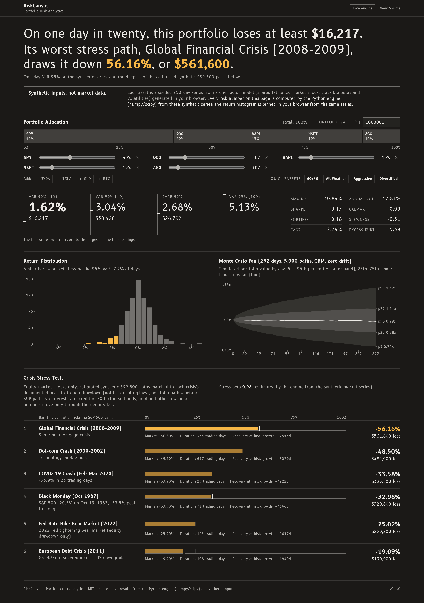

# RiskCanvas

[](https://github.com/ROROK20/RiskCanvas/actions/workflows/ci.yml)
[](https://python.org)
[](LICENSE)
[](CONTRIBUTING.md)

RiskCanvas is a Python library, REST API and demo dashboard for portfolio risk (VaR, expected shortfall, Monte Carlo and crisis stress tests), built so you can check its numbers by hand.

- **Stress drawdowns you can derive.** Each crisis figure is `trough / peak − 1` of [cited S&P 500 closes](#stress-scenarios), to 0.1 point, and a beta-1 portfolio gets exactly that figure over HTTP. Proof: `pytest tests/test_api.py -k reproduces_documented_table`.
- **Expected shortfall that handles ties exactly.** 97 flat days and three of -10% give CVaR95 = 6%, where averaging every day at or below VaR reads 0.3%. Proof: `pytest tests/test_risk_metrics.py -k TestExpectedShortfallWithTies`.

**Live demo:** https://riskcanvas-roan.vercel.app (in-browser estimates on synthetic return series, labelled as such; run the API for the real engine).

**Run it:** `docker compose up --build` in a clone, then open http://localhost:3004. [Other ways](#run-the-full-stack).

**Demo and research software, not financial advice.** The dashboard's inputs are synthetic, seeded return series, not market data; the library and API take your own returns or yfinance prices.

<p align="center">
  
  <br>
  <em>Captured 2026-11-05. Build a portfolio and the real engine returns VaR/CVaR, a return distribution, a Monte-Carlo fan chart and six crisis stress scenarios. <code>docker compose up</code> for the full stack.</em>
</p>

---

## Why trust the numbers

Each claim has a test or command behind it. The tests need no network: `pytest tests/` ([Testing](#testing)).

- **Stress figures trace to cited closes.** [`test_readme_tables_match_the_engine`](tests/test_stress.py) parses this README's tables and checks them against the engine's closes, dates and paths. [`test_stress_market_portfolio_reproduces_documented_table`](tests/test_api.py) requires them over HTTP, and `make smoke` requires them from the running API and on the rendered page.
- **Risk math is checked by hand.** [`TestHandComputedVaR`](tests/test_risk_metrics.py) and [`TestExpectedShortfallWithTies`](tests/test_risk_metrics.py) compare VaR and expected shortfall with values worked out on paper.
- **Three Monte Carlo engines, compared, with their error reported.** GBM, multivariate Student-t and a circular block bootstrap each return standard errors. [`test_reported_error_matches_the_spread_across_seeds`](tests/test_monte_carlo.py) checks those against the real spread across seeds, and [`test_readme_t5_ratios_at_95_and_99_percent`](tests/test_monte_carlo.py) pins the [comparison quoted below](#monte-carlo-methods).
- **It says when the input can't support the answer.** Too little history is flagged ([`test_short_history_flags_analyze_montecarlo_and_stress`](tests/test_api.py)), and a series that reads as percent is refused rather than rewritten ([`test_a_bond_fund_in_percent_is_a_422`](tests/test_api.py)).
- **The published figures are the engine's.** [`test_the_captured_cards_are_what_the_engine_computes_for_the_captured_request`](tests/test_capture.py) fails if the screenshot stops matching what the engine returns for the request it records.

**Known limits.** Stress scenarios are equity-market shocks on calibrated synthetic paths, not replays: no rate, credit or FX factor, and exact at beta 1 only. Long-only, one currency. See [Stress Scenarios](#stress-scenarios) for the size of each gap.

---

## Run the full stack

The Next.js dashboard is wired to the **real Python engine**. Its inputs are
**synthetic**: seeded per-asset return series from a one-factor model
(a shared fat-tailed market shock, plausible betas and volatilities) generated
in the browser — not market data, and the dashboard says so on screen. The UI
sends those series to the API, which computes VaR / CVaR / stress /
Monte-Carlo with **numpy/scipy** — fully offline, no market-data network calls.

```bash
git clone https://github.com/ROROK20/RiskCanvas.git
cd RiskCanvas
docker compose up --build      # or:  make demo
```

Then open **http://localhost:3004**. A **"Live engine"** label in the
header confirms the dashboard is talking to the FastAPI engine on
**http://localhost:8004**. Adjust allocations and the real engine recomputes
every metric.

**No Docker?** Run the same stack locally:

```bash
make demo-local
# API → http://localhost:8004   |   UI → http://localhost:3004
```

### Architecture

```
Browser (Next.js 15, :3004)
  │  POST /portfolio/{analyze,var,stress,montecarlo}  (per-asset return series)
  ▼
FastAPI engine (:8004)  ──►  riskcanvas core: numpy / scipy
  │                            • RiskMetrics      (VaR, CVaR, drawdown, vol)
  │                            • PerformanceMetrics(Sharpe, Sortino, Calmar, CAGR)
  │                            • StressTester      (6 calibrated crisis scenarios)
  └─ real JSON results  ◄──    • MonteCarloSimulator (GBM / Student-t / bootstrap)
```

> With no API configured, or if the API fails, the frontend
> falls back to its in-browser demo data (a **"Demo data"** label lights up, and
> the banner says which of the three happened: no engine connected, the engine could
> not be reached in time, or it answered with an error), so `npm run build` and a
> static, no-backend deploy still render.

### Deploy

- **Frontend → Vercel.** `frontend/vercel.json` is included. Import the repo and
  set the root directory to `frontend/`. **Set `NEXT_PUBLIC_API_URL` in the
  Vercel project's Environment Variables** (Settings → Environment Variables) to
  your deployed API URL. Next inlines it at **build** time, so set it before
  building (a value set only at runtime has no effect). A production build
  without it ships in demo-data mode and makes **no** engine calls: only
  `next dev` falls back to `http://localhost:8004`, so a public deploy can
  never call its visitors' own machines (`frontend/lib/apiUrl.mjs`, tested).
  For the frontend Docker image pass it as a build arg
  (`--build-arg NEXT_PUBLIC_API_URL=…`). Set **`NEXT_PUBLIC_SITE_URL`** (the
  site's public origin, e.g. `https://riskcanvas.example`) the same way to
  publish the social-preview image: link previews need an absolute URL, so
  without it a production build ships no `og:image` rather than one on
  localhost (`frontend/lib/siteUrl.mjs`, tested; only `next dev` falls back
  to `http://localhost:3004`). That image shows the demo-data state a
  frontend-only deploy serves ([Published images](#testing)).
- **API → Render (or any Docker host).** `render.yaml` is a one-click Render
  Blueprint that builds the root `Dockerfile` and serves `/health`. Any platform
  that runs the `Dockerfile` works (Fly.io, Railway, a VM, etc.).
  **It puts the engine on the public internet as-is:** no authentication, no
  rate or concurrency limit, no request-body limit, no reverse proxy, on
  Render's free plan. One request at the caps costs about 2 s of CPU on an
  8-core laptop (`/portfolio/analyze` 2.1 s, Monte Carlo 0.4–1.7 s; measured
  2026-11-03, [SECURITY.md](SECURITY.md#demo-api-surface-fastapi)), far more
  wall-clock on a small instance, so a few concurrent requests can saturate it.
  Before sharing the
  URL, put a reverse proxy with body-size and rate limits in front of it,
  or keep the API private and deploy the frontend in demo-data mode.

---

## Table of Contents

- [Why trust the numbers](#why-trust-the-numbers)
- [Run the full stack](#run-the-full-stack)
- [Features](#features)
- [Quick Start](#quick-start)
- [Stress Scenarios](#stress-scenarios)
- [Monte Carlo Methods](#monte-carlo-methods)
- [REST API](#rest-api)
- [Web Demo / Frontend](#web-demo--frontend)
- [Testing](#testing)
- [Project Structure](#project-structure)
- [Documentation](#documentation)
- [Contributing](#contributing)
- [Security](#security)
- [Code of Conduct](#code-of-conduct)
- [Changelog](#changelog)
- [License](#license)

---

## Features

- **VaR suite** — Historical and parametric (normal, closed-form) 1-day VaR/CVaR at 90/95/99% confidence, plus square-root-of-time 10-day VaR (capped at a total loss); Monte Carlo VaR/CVaR at 95/99% over any horizon
- **Monte Carlo** — 3 methods: GBM, multivariate Student-t (fat daily tails that survive diversification), circular Block Bootstrap (non-parametric)
- **Stress testing** — 6 crisis scenarios (Black Monday 1987, Dot-com 2000, GFC 2008, Euro Debt 2011, COVID 2020, 2022 Bear): deterministic stylized paths, each calibrated to the crisis's S&P 500 peak-to-trough drawdown, scaled by the portfolio's beta — plus custom shocks
- **Performance analytics** — Sharpe, Sortino, Calmar, Omega Ratio, and `factor_exposure`: an OLS regression on factor series you supply (alpha + loadings, point estimates only)
- **Correlation analysis** — Correlation and annualized covariance matrices (`/portfolio/analyze` returns the correlation matrix)
- **REST API** — FastAPI endpoints for VaR/CVaR, performance, the six stress scenarios and Monte Carlo; `factor_exposure`, `custom_shock` and the rolling and ratio helpers are Python only
- **Web demo** — Next.js 15 dashboard wired to the real FastAPI engine (graceful demo-data fallback when offline)

---

## Quick Start

```bash
git clone https://github.com/ROROK20/RiskCanvas.git
cd RiskCanvas
python3 -m venv .venv && source .venv/bin/activate   # Windows: .venv\Scripts\activate
pip install -e ".[dev]" -c requirements.txt
```

> `-c requirements.txt` applies the pinned, reproducible dependency set (the
> same one the Dockerfile installs). Drop the flag to resolve latest-compatible
> versions instead — `setup.py` declares floors, `requirements.txt` the pins.
> RiskCanvas supports Python 3.11+; the pins need **Python 3.12+** (numpy
> 2.5.1 and scipy 1.18.0 publish no 3.11 wheels), so on 3.11 drop the flag.

```python
from riskcanvas.portfolio.loader import PortfolioLoader
from riskcanvas.metrics.risk import RiskMetrics
from riskcanvas.metrics.performance import PerformanceMetrics
from riskcanvas.simulation.monte_carlo import MonteCarloSimulator
from riskcanvas.scenarios.stress_test import StressTester

# Load portfolio (fetches live prices via yfinance)
loader = PortfolioLoader()
portfolio = loader.from_tickers(
    {"AAPL": 0.30, "MSFT": 0.30, "GOOGL": 0.20, "AMZN": 0.20},
    start="2020-01-01",
    end="2023-12-31",
)

returns = portfolio.portfolio_returns

# Risk metrics
risk = RiskMetrics(returns).compute_all()
print(f"VaR 95% (1-day): {risk.var_95_1d:.2%}")
print(f"CVaR 95%:        {risk.cvar_95:.2%}")
print(f"Max Drawdown:    {risk.max_drawdown:.2%}")
print(f"Annual Vol:      {risk.annual_vol:.2%}")

# Performance metrics
perf = PerformanceMetrics(returns).compute_all()
print(f"CAGR:    {perf.cagr:.2%}")
print(f"Sharpe:  {perf.sharpe:.2f}")
print(f"Sortino: {perf.sortino:.2f}")
print(f"Calmar:  {perf.calmar:.2f}")

# Monte Carlo simulation (50k paths, 1-year horizon)
sim = MonteCarloSimulator(n_paths=50_000)
mc = sim.simulate_gbm(portfolio, horizon_days=252)
print(f"P(Loss): {mc.prob_loss:.1%}")
print(f"E[1Y]:   {mc.expected_terminal:.3f}x")
print(mc.percentile_table.to_string(index=False))

# Stress testing: scale each scenario by the portfolio's beta to the S&P 500
beta, estimated = StressTester().estimate_beta_detailed(portfolio)  # downloads SPY
tester = StressTester(beta_to_spy=beta)
print(f"beta {beta:.2f} ({'estimated' if estimated else 'ASSUMED 1.0: SPY unavailable'})")
for s in tester.run_all(portfolio):
    print(f"{s.scenario_name[:30]:30s}: {s.portfolio_drawdown:.1%}")
```

> **Offline mode.** No internet? Build a portfolio from your own daily returns
> with `loader.from_returns_df(returns_df, weights=...)` or from a CSV with
> `loader.from_csv("returns.csv", ...)` — no network or API keys required.
> Both enforce the same rules as the REST API: weights long-only and
> normalised by their sum (`{"A": 60, "B": 40}` → 0.6 / 0.4), every weighted
> ticker present (a missing one is a `ValueError`, never dropped), dates
> strictly increasing, values finite fractions in [-1, 10], and a column that
> reads as percent or as levels (gross returns, prices) refused (below). A missing value (an empty CSV cell) is a
> `ValueError` naming the column and dates, never a 0% day; `missing="drop"`
> explicitly excludes those dates instead. See [docs/usage.md](docs/usage.md).

---

## Stress Scenarios

> **Equity-market shocks only.** Every scenario is an S&P 500 path scaled by
> the portfolio's beta to the S&P 500. There is **no interest-rate, credit,
> FX or commodity factor**, so a bond, gold or other low- or negative-beta
> portfolio barely moves, or gains, in every scenario, including "Fed Rate
> Hike Bear Market (2022)", whose bond losses are not modelled. A long-bond
> portfolio with beta -0.29 ends that scenario up +8.8% (`total_loss`; max
> drawdown -3.4%) and the GFC up +27.3%. `/portfolio/stress`
> flags such portfolios in `warnings` (below); read their results as "no
> equity-market loss", not as a rate or credit stress.

| Scenario | S&P 500 peak close → trough close | Drawdown | Trading days |
|----------|-----------------------------------|----------|--------------|
| Black Monday | 1987-08-25 336.77 → 1987-12-04 223.92 | -33.5% | 71 |
| Dot-com Crash | 2000-03-24 1527.46 → 2002-10-09 776.76 | -49.1% | 637 |
| Global Financial Crisis | 2007-10-09 1565.15 → 2009-03-09 676.53 | -56.8% | 355 |
| European Debt Crisis | 2011-04-29 1363.61 → 2011-10-03 1099.23 | -19.4% | 108 |
| COVID-19 Crash | 2020-02-19 3386.15 → 2020-03-23 2237.40 | -33.9% | 23 |
| Fed Rate Hike Bear | 2022-01-03 4796.56 → 2022-10-12 3577.03 | -25.4% | 195 |

*Closes checked 2026-10-30 against Yahoo Finance `^GSPC` daily closes
(`yfinance`); drawdown = trough / peak − 1, close to close, to 0.1 point.*

**What a scenario is.** A deterministic, **calibrated synthetic** daily-return
path for the S&P 500, not a historical replay:

- **Calibrated on the peak-to-trough drawdown.** A hand-written stylized
  shape (drift, crash days, relief rallies) is multiplied by one factor,
  fitted so the path's max drawdown, measured from pre-crisis capital, equals
  the table's figure.
- **One step per trading day** of the real window, and the path **ends at its
  trough**, as the real window (peak close to trough close) does. So for a
  beta-1 portfolio `/portfolio/stress` returns the table's figure as both
  `portfolio_drawdown` (max drawdown) and `total_loss` (end-of-window
  return), and `duration_days` is the window's trading days. `GET /scenarios`
  lists each window's dates, trading days and calendar days.
- **Daily values are stylized, not the index's.** The fitted factor moves
  every day alike. Black Monday's and COVID's shapes are written so the
  factor is about 1 and the crash day matches the real one (both tested). The
  other four are smooth grinds with a fraction of the real daily volatility:

| Scenario | Path: worst day / daily σ | Real ^GSPC window: worst day / daily σ |
|----------|---------------------------|----------------------------------------|
| Black Monday | -20.52% / 2.98% | -20.47% (1987-10-19) / 3.38% |
| Dot-com Crash | -0.80% / 0.13% | -5.83% (2000-04-14) / 1.45% |
| Global Financial Crisis | -6.41% / 0.55% | -9.03% (2008-10-15) / 2.39% |
| European Debt Crisis | -5.58% / 0.84% | -6.66% (2011-08-08) / 1.72% |
| COVID-19 Crash | -11.92% / 4.92% | -11.98% (2020-03-16) / 5.03% |
| Fed Rate Hike Bear | -0.55% / 0.37% | -4.32% (2022-09-13) / 1.52% |

*Real columns: daily close-to-close returns of `^GSPC` (`yfinance`) over each
peak-to-trough window, measured 2026-11-01. `tests/test_stress.py` checks
both tables against the engine.* Use the scenarios for drawdown magnitude
and duration, not for daily volatility, daily VaR or liquidity analysis.

A portfolio's path is `beta × S&P 500 path`, day by day: a position
rebalanced daily to beta times the index's daily move. **Only beta 1
reproduces the table exactly**, for all six scenarios (to the 4 decimals the
API returns; enforced by `tests/test_stress.py`, `tests/test_api.py` and the
live-fire driver). Beta 0 gives 0. Supply beta explicitly, or estimate it first.
`StressTester()` with no beta applies an **assumed** 1.0, whose results are the
S&P 500's own drawdowns: it says so, in `tester.beta_assumed` and a logged warning
when it first runs a scenario. See [REST API](#rest-api) for how
`/portfolio/stress` resolves and reports its beta.

**At any other beta the figure is an approximation whose error depends on
how rough the path is.** Compounding beta-scaled daily moves carries a
volatility drag of about `(β − β²)·Σr²/2` in log terms relative to scaling
the index's log return. The calibration fixes the beta-1 drawdown, not the
path's roughness, and most synthetic paths are far smoother than the index
(table above). Below beta 1 the engine is therefore more severe than the
same daily-rebalanced position on the real `^GSPC` window. Above beta 1 it
is less severe, by up to 3.2 points at beta 2 (Dot-com and GFC):

| Scenario | Beta 0.5: engine / real path | Beta 2: engine / real path |
|----------|------------------------------|----------------------------|
| Black Monday | -17.8% / -17.7% | -59.6% / -60.4% |
| Dot-com Crash | -28.6% / -27.5% | -74.1% / -77.4% |
| Global Financial Crisis | -34.2% / -32.5% | -81.6% / -84.8% |
| European Debt Crisis | -10.1% / -9.9% | -35.6% / -37.1% |
| COVID-19 Crash | -18.1% / -18.1% | -59.1% / -59.2% |
| Fed Rate Hike Bear | -13.6% / -13.2% | -44.5% / -46.9% |

*Real path: max drawdown, from pre-crisis capital, of `∏(1 + β·r)` over the
daily `^GSPC` close-to-close returns of each peak-to-trough window
(`yfinance`), measured 2026-11-01; the engine column is
`StressTester(beta_to_spy=β)`. `tests/test_stress.py` checks both columns
and the direction of every gap.* Read beta ≠ 1 results as first-order
estimates, accurate to within gaps of the size shown, and expect them to
understate the loss of a high-beta portfolio.

```python
# Custom shock: an S&P 500 decline of 40% spread geometrically over 45
# trading days (duration_days=1 is a one-day shock), scaled by the tester's
# beta like the built-in scenarios
result = tester.custom_shock(portfolio, equity_shock=-0.40, duration_days=45, name="Custom Crash")
print(result.portfolio_drawdown)
```

Scenario keys: `black_monday_1987`, `dotcom_crash`, `gfc_2008`,
`covid_crash_2020`, `rate_hike_2022`, `european_debt_crisis`.

---

## Monte Carlo Methods

GBM and Student-t correlate their per-asset shocks with an exact factor of
the historical covariance matrix: Cholesky, or its eigen square root when the
matrix is singular (a riskless cash leg, collinear assets), and no jitter, so
a constant series simulates with zero volatility. Student-t is a **multivariate** t: each
path-day shares one chi-square mixing variable across all assets, scaled to
unit variance, so the covariance is the same as GBM's and every portfolio of
the assets is itself t-distributed (a fat-tailed day hits every asset at
once, so the tails do not average away as assets are added). The block bootstrap is **circular** (Politis &
Romano): each 20-day block starts at a uniformly drawn day and wraps from the
last observation to the first, so every historical day is equally likely at
every day of a path. Its outcomes recombine overlapping historical windows, so
the history holds only about `n_obs / horizon` independent horizon-length
windows; under 100 the response warns `few_bootstrap_windows` (300
observations at 10 days: 30), whatever `n_paths` is. It needs no covariance
model: it resamples 20-day blocks of the portfolio's own historical returns
(each resampled day is a real day for every asset, so co-movement carries
over), and requires at least one block of history. Every result carries
`percentile_bands` — the 5/25/50/75/95th percentiles of simulated portfolio
value at checkpoint days across the horizon — which the dashboard's fan chart
draws directly. Under Student-t shocks the *mean* terminal value is not a
stable statistic (the t has no moment-generating function); read its
percentiles and VaR/CVaR.

**Drift is zero by default** (`MonteCarloSimulator(drift=...)`, and the
`drift` query parameter, echoed in every response): no expected return is
projected, the risk-desk convention, so a strong sample cannot turn the tail
into a gain. `historical` uses the in-sample mean and `risk_free` 2% a year; the bootstrap re-centres the history
to the chosen mean. On two years at exactly +0.12% a day and 0.8% daily
volatility, the one-year GBM VaR 99% is 26.3% at zero drift and +0.2% with
historical drift (VaR 95% -8.8%, a gain; P(loss) 1.0%); the API then warns
`historical_drift_gain` (measured 2026-11-02, 20,000 paths, seed 5).

All three models rebalance to the fixed weights every day (GBM and Student-t
blend the per-asset daily moves with the weights; the bootstrap resamples the
daily-rebalanced portfolio series); buy-and-hold weight drift is not
modelled. Every result carries `standard_errors`, the Monte Carlo sampling
error of each estimate (simulation noise only, how far another seed would
move it; not the estimation error of a finite history, which is often
larger, and which the response's `standard_errors_note` states) (VaR: a distribution-free order-statistic interval;
CVaR: the asymptotic expected-shortfall variance; the mean and probability of
loss: their textbook forms). Over HTTP, `n_paths` is 1,000 to 100,000, and
`seed` (default 42, echoed in the response) fixes the sample: identical
requests return identical results, and another seed draws an independent one.

```python
sim = MonteCarloSimulator(n_paths=100_000)

# Standard GBM (log-normal returns)
gbm = sim.simulate_gbm(portfolio, horizon_days=252)

# Multivariate Student-t: fatter DAILY tails (see the horizon note below)
t_dist = sim.simulate_t_distribution(portfolio, horizon_days=252, df_t=5)

# Historical block bootstrap (non-parametric)
bootstrap = sim.simulate_bootstrap(portfolio, horizon_days=252, block_size=20)

# Compare tail risk
print(f"GBM VaR 99%:       {gbm.var_99:.2%}")
print(f"Student-t VaR 99%: {t_dist.var_99:.2%}")
print(f"Bootstrap VaR 99%: {bootstrap.var_99:.2%}")
```

**How much fatter, by horizon.** The t's tails are fat per day; days are
independent, so over a long horizon their sum tends to a normal and the
models converge. On [docs/usage.md](docs/usage.md)'s example portfolio
(50,000 paths, seed 42, default zero drift, measured 2026-11-02) Student-t
(df 5) VaR 99% over
GBM's is **1.12 at 1 day, 1.03 at 10 days and 1.01 at 252 days**. At 95% the
t's 1-day VaR is LOWER than GBM's, **0.95 at 1 day** (theory for a
unit-variance t5: 0.949): with the same variance the t puts more mass near
the centre and in the far tail and less in between, so its 95% quantile sits
closer to the mean and its 99% quantile further out. The model
has no volatility clustering; for fat tails over longer horizons, the block
bootstrap resamples real days, crisis runs included.

---

## REST API

```bash
uvicorn riskcanvas.api.app:app --port 8004
# interactive OpenAPI docs at http://localhost:8004/docs

curl -X POST http://localhost:8004/portfolio/analyze \
  -H "Content-Type: application/json" \
  -d '{"weights": {"AAPL": 0.4, "MSFT": 0.3, "GOOGL": 0.3}, "start": "2020-01-01"}'

curl -X POST http://localhost:8004/portfolio/stress \
  -H "Content-Type: application/json" \
  -d '{"weights": {"SPY": 0.6, "AGG": 0.4}, "start": "2018-01-01"}'
# -> measured 2026-10-31: "beta_used": 0.618, "beta_source": "spy_leg"; GFC
#    -40.4% for this 60/40, not the S&P 500's -56.8% (live data, so it drifts).
#    At beta != 1 that is an approximation: the same daily-rebalanced 0.618
#    position on the real ^GSPC GFC window bottoms at -39.0% (measured
#    2026-11-01; see Stress Scenarios)

curl -X POST "http://localhost:8004/portfolio/montecarlo?n_paths=10000&horizon_days=252&method=t" \
  -H "Content-Type: application/json" \
  -d '{"weights": {"AAPL": 0.5, "NVDA": 0.5}, "start": "2021-01-01"}'
```

Endpoints: `POST /portfolio/analyze`, `POST /portfolio/var`,
`POST /portfolio/stress`, `POST /portfolio/montecarlo`, `GET /scenarios`,
`GET /health`.

A body that is not JSON is a `422` (`json_invalid`). Bytes are decoded as Python's JSON
parser decodes them: UTF-8, or UTF-16 or UTF-32 told apart by the first bytes, with or
without a byte-order mark. A body that none of those decode (Latin-1, say), or that is
nested past the parser's limit, is FastAPI's `400`.

**Request rules** (all enforced; violations return `422`, never a silent
rewrite). Numbers are JSON numbers and dates ISO strings: `true`, `"0.5"`, and
`0` or a timestamp as a date are a `422`, not coerced.

- `weights` — long-only: every weight finite and `>= 0`, with a positive,
  finite sum (weights whose sum overflows floating point, such as two of
  `1e308`, are a `422`). They are normalised to sum to 1 (the only
  transformation applied). Short positions (negative weights) are rejected:
  RiskCanvas models long-only portfolios. The rule is one function,
  `check_weights`, shared with the offline loaders.
- `returns` (optional) — exactly one series per ticker in `weights`, all the
  same length (aligned daily observations, 2–20,000 each), every value a
  finite fraction in [-1, 10]. A series that reads as percent is a `422`: a
  quiet asset in percent stays inside that range (a bond fund's -0.5 is -0.5%,
  and would be read as -50%), so 20 or more observations with up and down days
  whose median absolute return is 0.10 to 1.0 are refused (at a normal
  distribution's shape that is about 15% daily volatility, 235% a year).
  A series that reads as levels is a `422` too: gross returns (`1.01, 0.99`) and
  prices under 10 stay inside the range, and would read as a gain of 100% or more
  every day, so 5 or more observations, at least 95% of them above zero, with a
  median of 0.10 or more, are refused. `market_returns` obeys both rules. With
  `periods_per_year` under 252 those floors grow with the square root of the time one
  observation spans, as volatility does: 0.22 weekly, 0.46 monthly and, for levels, at
  most 0.75, which still catches gross returns. At one or two observations a year the
  percent rule cannot fire: such a file almost always has a move below -1 (out of
  range) or reads above 100% volatility (`implausible_statistics`).
  `"allow_large_returns": true` accepts a window that really is that violent;
  implausible figures are then flagged (`implausible_statistics`, below).
  The limits: a percent series quieter than that (cash-like, typically under
  0.1% a day) cannot be told from fractions and is not caught, so check
  `annual_vol` against what you loaded; nor are prices under 0.10. With `returns` the engine runs offline and
  treats the series as consecutive business days starting at `start` (a
weekend `start` moves to the next Monday, reported in `warnings` as
`start_moved_to_business_day`; with no `start`, a series too long for the
2020-01-01 default is dated back to end today, `start_derived_from_today`); the
  last of those dates must fall on or before today (a `422` otherwise, e.g.
  for `start` 9999-01-01). Calendar statistics (`period`, `positive_months`)
  use these assumed dates, which carry no exchange holidays.
- `start` / `end` — ISO date strings (`YYYY-MM-DD`); `end` after `start`, with
  or without `returns` (which does not use `end`). Without `returns`, prices
  are downloaded per ticker via yfinance (at most 20 tickers).
- Live mode (no `returns`) — every requested ticker must have prices for the
  window. A ticker with none (a typo, a delisted symbol, a failed download) is
  a `422` naming it; it is never dropped with the other weights rescaled. A
  ticker whose history starts more than 7 calendar days after `start`
  (listed later), or ends more than 7 before `end` (delisted; with `end`
  omitted, before today), is a `422` naming its first or last available date,
  even when it is the only ticker. A gap of more than 12 calendar days inside a
  ticker's history, or between sessions common to every ticker, is a `422` naming
  the ticker and dates. Regular closures fit under that: the longest run to 11
  calendar days between sessions (Tokyo's Golden Week 2019, Shanghai's Lunar New
  Year and National Day weeks; recalled from the exchange calendars, not re-checked
  against them), and a neighbouring holiday on a mixed portfolio can add a day. For
  a longer closure, pass `max_gap_days` (1 to 366), which the `422` names: it sets
  the limit inside the window and at both ends, the return across a gap then spans
  all of it, and one over 12 days is flagged as `long_gap_spanned`. A halt or
  missing data is better left out of the window. At the ends of the window the
  default stays 7, so a late listing is not mistaken for a closure, and a window
  that starts or ends inside a long closure needs moving or `max_gap_days`.
  Prices are never back- or forward-filled: they are aligned on the
  sessions every ticker traded, which absorbs smaller offsets (weekends,
  exchange holidays). Every endpoint reports the window it used as `period`
  and `n_observations`. **No FX conversion:** each ticker's prices are used in
  its own listing currency, so `{"7203.T": 0.5, "AAPL": 0.5}` blends yen and
  dollar returns without the USD/JPY move, and the figures hold only for a
  single-currency portfolio. Convert first and send `returns`.
- `beta` (optional) — explicit beta to the S&P 500, `|beta| <= 4`.
- `market_returns` (optional) — S&P 500 (e.g. SPY) daily returns aligned with
  `returns`.
- `periods_per_year` (optional, only with `returns`) — observations per year of a
  series that is not daily, a whole number from 1 to 365 (12 for monthly, 52 for
  weekly). The annual figures use it, the observations are dated at that rate, and
  CAGR's years are `n / periods_per_year`. Without it `returns` are read as daily:
  120 monthly returns of 12% true volatility read 55% (× √21), and a seeded CAGR of
  4.2% read +136% (measured 2026-11-04, `tests/test_api.py`).
- Unknown names — a body field the API does not define, or a query parameter the
  endpoint does not take, is ignored rather than refused, so a client that sends more
  keeps working. Every portfolio endpoint names it in `warnings` as `ignored_fields`,
  so a misspelt `periods_per_yeer` does not pass in silence.

**`/portfolio/var` keys name their horizon.** Per confidence level (90, 95,
99%), in currency units of `portfolio_value` at full floating-point precision
(never rounded, so `portfolio_value=1` returns fractions of the portfolio),
positive = loss: `var_1d` and `cvar_1d` (historical, 1-day), `var_10d`
(`var_1d × √10`, which assumes i.i.d. daily returns with zero mean: a
constant +1% a day scales to -3.16% where 10 days actually return +10.46%),
`var_parametric_1d` and
`cvar_parametric_1d` (normal, closed form: `CVaR = −μ + σ·φ(z)/α`). The two historical estimators differ
by design: VaR is minus numpy's linearly interpolated `1 − c` quantile;
CVaR is the discrete Acerbi–Tasche expected shortfall, the average of the
worst `k = n·(1 − c)` days with the boundary day fractionally weighted (so
ties at the VaR cannot dilute it). Monte Carlo VaR/CVaR use the same pair.
One formula serves every series, constant ones included: VaR is minus the
tail quantile, so it is negative when even that quantile is a gain (a
constant +1% series reports −1% historical and parametric alike, the same
convention as Monte Carlo VaR). Returns are ≥ −100%, so no horizon can lose
more than the portfolio: `var_10d` and the parametric figures are capped at
`portfolio_value` (a total loss). A capped `var_10d` means √10 scaling has
broken down for that series; simulate the horizon with
`/portfolio/montecarlo` instead.

**Annualisation follows the series' calendar.** Annual volatility, CAGR,
Sharpe and Sortino use the observations per year the dates imply, by one rule,
the first line that fits:

- Intraday spacing, or fewer than one observation a year: refused with a
  `ValueError`, a `422` over HTTP. Bars show neither how many sessions a year
  there are nor what the overnight gaps hold. In the library pass `periods=` to
  `RiskMetrics` / `PerformanceMetrics`.
- Monthly spacing: 12. Weekly spacing: 52.
- Daily on all seven weekdays: 365 (a 7-day asset alone; mixed with stocks it is
  aligned on common sessions).
- Daily on five weekdays: 252, whichever two days it closes (Sunday-Thursday as
  much as Monday-Friday). One exchange's holidays stay here: Shanghai's about 243 a
  year as much as New York's 252 (session counts recalled, not re-checked). The
  exception is over a year or more of dates holding 227 to 239 a year (90-95% of
  252), what two exchanges' common sessions leave: `{"7203.T": 0.5, "AAPL": 0.5}`
  holds about 235 (an estimate from the two markets' holidays, not a live count)
  and reads as measured, with `non_standard_calendar`. At 252 a seeded 235-a-year
  series read volatility 17.01% for 16.42% and CAGR 6.22% for 5.79% (measured
  2026-11-04, `tests/test_risk_metrics.py`). The line is a stated heuristic,
  `FULL_CALENDAR_SHARE`.
- Fewer than 14 daily dates cannot show a week: 252.
- Anything else: the **measured** rate, intervals between the dates over the
  years they span, with the warning `non_standard_calendar`. Sunday-Thursday and
  Monday-Friday tickers align on Monday-Thursday, about 209 a year; also two days
  a week, every other day, a 6-day week, quarterly.

Holes below 90% of a standard rate do not change it: each observation counts as
one session, as `missing="drop"` leaves them. If the returns instead span the holes
(an illiquid asset, tickers with few common sessions), that overstates volatility,
so a standard calendar holding under 90% of its rate over a year or more warns
`sparse_calendar`. CAGR's years count the dates there and on any measured rate
(growth per calendar year over the span, so days excluded as missing count as time
with no return); on a calendar that holds its standard rate they are `n / periods`,
so 252 returns are one year.
`/portfolio/analyze` reports the factor as `risk.periods_per_year`.
`horizon_days`, the `1d` / `10d` figures and `recovery_days_estimate` count
observations of the series, and every portfolio endpoint says when those are not
trading days: calendar days on a 7-day series (`calendar_day_horizon`), weeks,
months or whatever one observation is below 252 a year (`non_daily_horizon`).
`returns` mode dates its observations as business days, so it reads 252, unless
`periods_per_year` states the rate: then nothing is measured and only the horizon
warnings can apply. The 252 is then an assumption, and `/portfolio/analyze` says so
in `warnings` as `assumed_periods_per_year`, as does `/portfolio/montecarlo` under
`drift=risk_free`, which spreads its 2% a year over it. Read this way, a crypto series
shows √(252/365) of its annual volatility, 17% low. Stating `periods_per_year`, 252
included, removes the warning.

**The risk-free rate is 2% a year.** Sharpe, Sortino, downside volatility and
Omega measure excess return over `RISK_FREE` (0.02), spread evenly over the
series' observations per year. Over HTTP it is fixed, and `/portfolio/analyze`
states it as `risk_free_rate`; in the library pass `risk_free_rate=` to
`RiskMetrics` / `PerformanceMetrics`. `avg_win` and `avg_loss` average the gaining
and the losing days; a flat day counts as neither.

**Thin histories are flagged, not hidden.** A series may be as short as 2
observations, so every portfolio endpoint returns `warnings` (a list of
`{code, message}`, empty when none apply): `short_history_tail` when a
historical VaR/CVaR level rests on fewer than one tail observation (90%
needs 10 observations, 95% 20, 99% 100), and `short_history` below 20
observations, the beta minimum, for any mean/volatility/covariance estimate
(parametric VaR, Monte Carlo, the stress recovery drift). The figures are
still returned. Also: `var_10d_capped` when √10 scaling hits the total-loss
cap, and on `/portfolio/montecarlo` `drift_removes_extreme_trend` when the
default zero drift re-centres away an in-sample trend larger than half a
daily standard deviation (a -100%-every-day series would otherwise simulate
zero risk). On `/portfolio/analyze` and `/portfolio/var`,
`implausible_statistics` when a historical VaR falls outside 0 to 100% (negative:
even that tail of the days is a gain), the CAGR passes +1,000% a year, or the
annual volatility passes 100% (stated heuristics, `IMPLAUSIBLE_CAGR` and
`IMPLAUSIBLE_ANNUAL_VOL`): a cash-like, steadily rising or very volatile series or a
very short history can do that, and so can input that is not daily fractional
returns, such as a quiet bond fund in percent (daily 0.12 reads 194%). For `returns`
read as daily, with no `periods_per_year`, also when volatility passes 50% and CAGR
+100% together (`NON_DAILY_ANNUAL_VOL`, `NON_DAILY_CAGR`), which monthly returns can
read as. The limit: a monthly or weekly series under either line reads plausibly and
is not flagged (monthly at 60% with +73% is not, and weekly rarely reaches 50%), so
state its rate.

**Undefined statistics are `null`, never a 500.** A ratio with a zero
denominator (`sharpe` at zero volatility; `sortino`, `calmar`,
`profit_factor` when unbounded or 0 / 0; `skewness`, `excess_kurtosis` and
`var_stress_multiplier` for a constant series) and a correlation that
involves a zero-variance series (a cash leg, any constant series; its own
diagonal included) are JSON `null`. A Monte Carlo run whose simulated values
overflow floating point, or pass 1e150 (where the standard errors would), is a
`422` that says so, under every `method` and `drift`. `tests/test_api.py` sweeps
degenerate inputs (cash legs, constant series, a -100% day, +1000% days,
subnormal drift) over every endpoint, and extreme returns over every `method` ×
`drift`, and requires a 200 or 422 with standard JSON.

**Exchanges in different regions do not close together.** Every endpoint pairs
same-date closes, and Tokyo's comes about 14 hours before New York's (exchange hours
recalled, not re-checked), so what New York does after it reaches Tokyo the next day. **Correlations and betas read low, so
diversification reads high and volatility, VaR and stress losses read low.** A
stylised 60/40 SPY / Tokyo mix whose Tokyo leg has beta 1.25, one session behind
(measured 2026-11-04, 1,500 observations, `tests/test_api.py`): a true beta of 1.1
reads 0.63, and the GFC -41% for -60%, volatility 15.1% for 19.8%, correlation 0.05
for 0.86. Every portfolio endpoint warns `non_synchronous_closes` when the held
tickers span regions, and `/portfolio/stress` also when it measures a beta for a
non-American ticker against the S&P 500. The regions come from the ticker's Yahoo
Finance suffix, a heuristic: the Americas (any ticker with no known suffix, so
`BTC-USD` and `^N225` count as American), Europe with the Middle East and Africa (`.L`, `.DE`, ...), and
Asia-Pacific (`.T`, `.HK`, ...). Exchanges inside one region are not flagged, though
Tokyo and Hong Kong close about 90 minutes apart. To reduce the bias, compound the
series over several days and send them as `returns` with `periods_per_year` (weekly,
that mix reads 1.01), or state a `beta`.

**How `/portfolio/stress` picks beta** — reported in every response as
`beta_used`, `beta_source` and a human-readable `beta_note`:

| `beta_source` | When |
|---|---|
| `explicit` | the request carries `beta` (0 means 0) |
| `market_returns` | OLS beta of the portfolio on the supplied `market_returns` |
| `spy_leg` | the portfolio holds `SPY`: OLS beta on its own SPY series |
| `yfinance_spy` | no `returns`: OLS beta on SPY downloaded for the same window, both legs compounded over the sessions both traded, so a 7-day or Sunday-Thursday asset is measured over the same intervals as SPY |
| `assumed` | none of the above is available: beta **1.0 is assumed**, and the note says the result is the S&P 500's own drawdown, not the portfolio's |

Every response also carries `beta_r_squared` (the R² of an estimated beta's
fit, `null` when beta was supplied or assumed) and `warnings`, a list of
`{code, message}` for each reason the equity-only scenarios may not
represent the portfolio (empty for an equity-like one):

| `code` | When |
|---|---|
| `low_equity_beta` | beta below 0.3: the S&P 500 path barely moves the portfolio, or (negative beta) makes it gain |
| `weak_equity_fit` | an estimated beta with R² below 0.3: the S&P 500 explains under 30% of the portfolio's daily variance |
| `assumed_beta` | `beta_source` is `assumed` |
| `non_synchronous_closes` | the tickers, or the tickers and a measured beta's S&P 500 series, close in different regions, so the beta and every loss read low (above) |

`recovery_days_estimate` is the trading days to regain the pre-crisis level
from the end of the window (`total_loss`), **compounding** at the portfolio's
historical geometric mean daily return (its CAGR): a rough guide that assumes
that growth resumes immediately. It is `null` when that growth is not positive,
and when the window ends at or above the pre-crisis level, as a negative-beta
portfolio's does. A linear `|drawdown| / mean daily return` would understate
deep drawdowns: a -50% drawdown needs +100%.

The two thresholds are stated heuristics
(`riskcanvas.scenarios.stress_test.LOW_EQUITY_BETA` / `LOW_R_SQUARED`), not
statistical tests; `scenario_fit_warnings(beta, r_squared)` computes them
in the library.

`/portfolio/montecarlo` takes `drift` (`zero` by default, `historical`,
`risk_free`), `n_paths` (1,000 to 100,000), `horizon_days`
(1 to 2,520), `method` (`gbm`, `t` or `bootstrap`, lower case; anything else
is a `422`) and `seed`, and additionally caps total work: `n_paths ×
horizon_days × n_assets` may not exceed 25,000,000 for `gbm` or 12,500,000
for `t` (see [SECURITY.md](SECURITY.md) for every bound).

---

## Web Demo / Frontend

A Next.js 15 dashboard that visualizes the analytics. It is wired to the
**real Python engine**: the UI sends **synthetic** per-asset return series —
a seeded one-factor model generated in the browser (`frontend/lib/mockRisk.ts`),
not market data — plus the synthetic market series they load on, to the
FastAPI service (`frontend/lib/liveRisk.ts` → `frontend/lib/api.ts`), which
computes VaR / CVaR / stress (with a beta estimated from that market series) /
Monte-Carlo with numpy/scipy. A banner on the page states that the inputs are
synthetic in every state. With no API configured, or if the API fails, it falls
back to approximate in-browser estimates from the same series (its stress
scenarios compound beta × the engine's own calibrated paths, copied into
`frontend/lib/scenarioPaths.mjs` and checked against the engine by
`tests/test_stress.py`, so no demo loss exceeds 100%) — so the
dashboard still renders with no API or market-data keys, and a static
no-backend deploy works out of the box.

An emptied portfolio (no asset, or every weight 0%) shows "Add an asset"
instead of results, and the caption always says what the numbers on screen
are (the last engine result while recomputing; "no result yet" before the
first) and why they are in-browser estimates when they are: no engine connected,
the engine could not be reached in time, or it answered with an error.

Moving a slider asks the engine once, 300 ms after the inputs stop changing, and a
newer change aborts a request still in flight (`frontend/lib/engineRequest.mjs`). Each
ask is three POSTs (`/analyze`, `/stress`, `/montecarlo`).

Point the UI at a deployed engine by setting `NEXT_PUBLIC_API_URL`; leave it
unset to run purely in demo-data mode.

```bash
cd frontend
npm install
npm run dev
# open http://localhost:3004
```

What CI runs for the frontend: lint, the unit tests (`node:test`, no
dependencies: the return histogram and the Monte Carlo fan bands) and the
production build:

```bash
cd frontend && npm run lint && npm test && npm run build
```

---

## Testing

```bash
pytest tests/

# with coverage (matches CI)
pytest tests/ --cov=riskcanvas --cov-report=term-missing -v
```

```
# tests/test_risk_metrics.py::TestRiskMetrics::test_cvar_ge_var PASSED
# tests/test_monte_carlo.py::TestMonteCarloSimulator::test_percentile_paths_ordered PASSED
# tests/test_stress.py::TestStressTester::test_high_beta_worse_drawdown PASSED
# tests/test_stress.py::TestRecoveryEstimate::test_negative_drift_gives_none_not_sentinel PASSED
# 1008 passed
```

*(1008 tests, green 2026-11-04 in a development environment that is not on the exact pins; the
last run in a fresh Python 3.12 venv on the pinned `requirements.txt` set was the same day, at 947
tests. CI runs them on the newest versions `setup.py` admits, on Python 3.11 and 3.12
(`pip install -e ".[dev]"`, no pins); the only job that installs the pins, `smoke`, runs the
live-fire driver, not pytest.)*

Or via the Makefile: `make test` (see `make help` for all targets).

**Published images.** `make capture` (`e2e/capture.mjs`) regenerates, in one run,
the README screenshot (`docs/screenshot.png`) from the live stack (a production
build with `NEXT_PUBLIC_API_URL` set, the engine, `next start`) and the
social-preview image every shared link shows (`frontend/public/og.png`, 1200×630)
from a production build with no engine, the state a frontend-only deploy serves:
the **"Demo data"** badge and its in-browser figures. It records both SHA-256
hashes, badges and metric cards in `docs/capture.json`, with the request the
dashboard sent (`docs/capture_request.json`). `tests/test_capture.py` fails if
either image changes without the other, if the preview stops being the demo state,
or if the engine stops computing the screenshot's cards from that request;
`make smoke` fails if the demo stops showing the preview's cards. A deploy with an
engine shows "Live engine" on the page and the same demo-state preview. Last
captured 2026-11-05.

**Live-fire smoke test** — end-to-end proof against the real engine: a
beta-1 portfolio reproduces all six documented drawdowns over HTTP, a
beta-0.3 portfolio scales every scenario down, an explicit beta of 0 gives 0,
a request with no market series is reported as `assumed`, the offline demo
mode (engine blocked in the browser) compounds the scenarios the engine's
way (100% TSLA: GFC -79.94%, every loss above -100%) and repeats the engine's
weak-fit warning (100% BTC), and a real browser, in English and in German,
renders the engine's results with the synthetic-input and stress-beta
disclosures and 0 console errors. It self-starts the API (:8004) and
dashboard (:3004), then tears both down:

```bash
(cd frontend && npm install && npx playwright install chromium)   # one-time
node e2e/smoke.mjs                                                 # exits 0 on success
```

---

## Project Structure

```
riskcanvas/
├── riskcanvas/
│   ├── portfolio/    # Data loading (yfinance, CSV, DataFrame)
│   ├── metrics/      # VaR, CVaR, Sharpe, Sortino, Calmar, factor exposure
│   ├── simulation/   # Monte Carlo: GBM, Student-t, block bootstrap
│   ├── scenarios/    # Drawdown-calibrated crisis scenarios + custom shocks
│   └── api/          # FastAPI REST service
├── frontend/         # Next.js 15 dashboard (real engine, demo-data fallback)
├── docs/             # architecture.md + usage.md
├── tests/
└── requirements.txt
```

---

## Documentation

- [docs/architecture.md](docs/architecture.md) — component & data-flow overview
- [docs/usage.md](docs/usage.md) — copy-paste Python API + REST examples

---

## Contributing

Contributions are welcome! See [CONTRIBUTING.md](CONTRIBUTING.md) for setup,
test, and PR guidelines. We use [Conventional Commits](https://www.conventionalcommits.org/).

## Security

Found a vulnerability? Please report it privately — see [SECURITY.md](SECURITY.md).
Do **not** open a public issue for security reports.

## Code of Conduct

This project follows the [Contributor Covenant](CODE_OF_CONDUCT.md).

## Changelog

See [CHANGELOG.md](CHANGELOG.md) for release history.

## License

MIT © [Rohan Khiani](https://github.com/ROROK20) — see [LICENSE](LICENSE).
